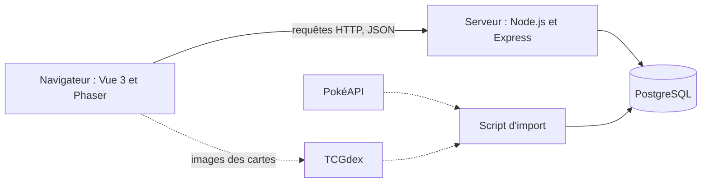
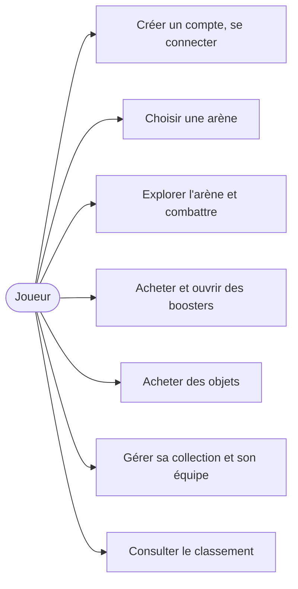
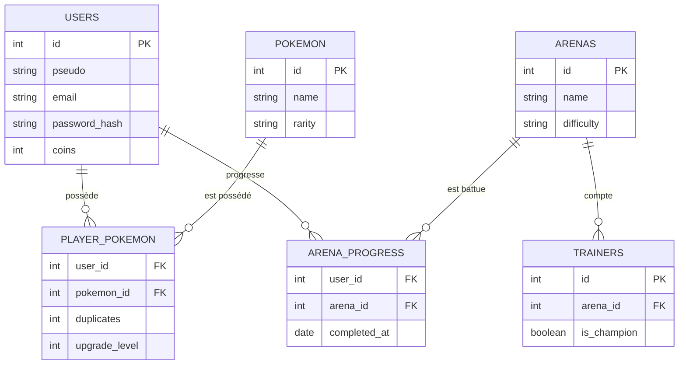

# Pok’Aréna : Spécification technique

**Équipe** : Clémentin LY (front-end), Emi LIM (game design), Clément BAS (back-end et base de données)

**Document lié** : [Fiche de cadrage](fiche-de-cadrage.md) (besoin, utilisateurs, état de l'art, concept et périmètre de la version 1).

Ce document détaille la solution technique du projet.

## Sommaire

1. [Solutions possibles](#1-solutions-possibles)
2. [Solution retenue](#2-solution-retenue)
3. [Points à définir](#3-points-à-définir)

---

## 1. Solutions possibles

### Solutions de concept

| Concept | Décision | Raison |
| --- | --- | --- |
| **Arènes et collection par boosters, 1ʳᵉ génération** | **Retenu** | Faisable, répond aux quatre profils |
| Remake d'un jeu complet | Écarté | Trop de contenu à produire |
| Roguelite façon PokéRogue | Écarté | Déjà réalisé |
| Gestion de sa propre arène | Écarté (évolution possible) | Éditeur d'arène trop lourd |
| Toutes les générations | Écarté | Trop de Pokémon à équilibrer |
| Jeu en 3D | Écarté | Trop lourd pour un navigateur |

### Solutions techniques

| Besoin | Options étudiées | Choix | Pourquoi |
| --- | --- | --- | --- |
| Front-end | Vue, React | **Vue 3** | Simple à prendre en main, bien documenté |
| Exploration 2D | Phaser, PixiJS, Canvas | **Phaser** | Gère cartes en tuiles, collisions et clavier. PixiJS et Canvas demandent de tout coder. |
| Back-end | Express, Fastify | **Express** | Simple et très répandu |
| Base de données | PostgreSQL, MongoDB | **PostgreSQL** | Données très liées entre elles (joueurs, collections, arènes) |
| Accès à la base | Sequelize, SQL direct | **Sequelize** | Modèles et migrations clairs |
| Connexion | JWT, sessions | **JWT** | Sans état côté serveur |
| Données Pokémon | PokéAPI, saisie à la main | **PokéAPI**, importée une fois en base | Évite de tout saisir. PokéAPI demande de ne pas la solliciter en permanence. |
| Cartes du JCC | TCGdex | **TCGdex** | Images officielles accessibles par une simple adresse |

---

## 2. Solution retenue

### 2.1 Fonctionnalités prévues

Les 16 fonctionnalités de la version 1, reprises de la fiche de cadrage, reliées aux écrans des wireframes.

| ID | Fonctionnalité | Écran |
| --- | --- | --- |
| F01 | Inscription et connexion | 1 |
| F02 | Sauvegarde de la progression côté serveur | tous |
| F03 | Équipe de départ | 7 |
| F04 | Carte des arènes : le joueur se déplace sur une ligne horizontale (inspiration Mario Bros) pour accéder aux arènes | 2 |
| F05 | Déblocage progressif des arènes | 2 |
| F06 | Exploration de l'arène en 2D | 3 |
| F07 | Énigme d'arène (rochers, interrupteurs) | 3 |
| F08 | Combats de dresseurs | 3, 4 |
| F09 | Combat contre le champion | 4 |
| F10 | Récompenses en pièces | 4 |
| F11 | Boutique de boosters (rareté et type, taux affichés) | 5 |
| F12 | Ouverture de booster avec cartes JCC | 6 |
| F13 | Boutique d'objets (potions, rappels, soins) | 5 |
| F14 | Collection, inventaire et équipe | 7 |
| F15 | Amélioration des Pokémon avec les doublons | 7 |
| F16 | Classement | 8 |

### 2.2 Règles de jeu

Les règles de la fiche de cadrage sont conservées. Pour le développement, nous retenons les principes suivants.

- **Le serveur décide.** Pièces, tirages de boosters, résultats de combat, déblocage des arènes et classement sont calculés par le serveur. Le navigateur affiche et envoie les actions du joueur.
- **Combat au tour par tour, sans hasard** (pas de coup critique ni d'attaque ratée) : à chaque tour, le joueur choisit une action (attaque, changement de Pokémon, objet), le serveur calcule le tour et renvoie le résultat.
- **Calcul des dégâts** : puissance de l'attaque, rapport entre l'Attaque de l'attaquant et la Défense de la cible, avec un bonus pour l'efficacité des types.
- **Statistiques** : l'indice de la rareté (100, 160, 250 ou 380) est réparti selon les stats réelles du Pokémon, comme décrit dans la fiche de cadrage. Chaque amélioration ajoute 5 % (5 améliorations au maximum, 10 doublons chacune).
- **Boosters** : le tirage des 6 Pokémon est fait par le serveur au moment de l'achat. Les taux sont stockés en base et affichés dans la boutique.
- **Défaite** : une défaite contre n'importe quel adversaire fait perdre l'arène, à recommencer depuis le début.
- **Reprise** : la progression dans l'arène en cours est sauvegardée, le joueur peut fermer le navigateur et reprendre plus tard.

### 2.3 Architecture logicielle

Trois parties : une application Vue dans le navigateur, une API Express, une base PostgreSQL.



- **Front-end** : Vue 3 pour les écrans (connexion, carte des arènes, combat, boutique, ouverture de booster, collection, classement). Phaser sert uniquement à l'exploration de l'arène (déplacement, collisions, énigme). Le combat et l'ouverture de booster sont en Vue et CSS.
- **Back-end** : API REST en JSON avec Express. Le code est séparé en routes, contrôleurs et services (règles de jeu : combat, boosters, boutique).
- **Base de données** : PostgreSQL, accédée avec Sequelize. Un script importe une seule fois les 151 Pokémon, leurs types et leurs attaques depuis PokéAPI, ainsi que les cartes TCGdex.
- **Connexion** : mot de passe haché (bcrypt), jeton JWT stocké dans un cookie `httpOnly` pour protéger la session.

**Principales routes de l'API**

| Domaine | Routes |
| --- | --- |
| Compte | `POST /api/auth/register`, `POST /api/auth/login`, `GET /api/auth/me` |
| Arènes | `GET /api/arenas`, `POST /api/arenas/:id/start` |
| Combats | `POST /api/battles`, `POST /api/battles/:id/actions` |
| Boutique | `GET /api/shop`, `POST /api/shop/boosters/:id/buy`, `POST /api/shop/items/:id/buy` |
| Collection | `GET /api/collection`, `POST /api/collection/:id/upgrade`, `PUT /api/team` |
| Classement | `GET /api/leaderboard` |

### 2.4 Langages et librairies

| Domaine | Technologie |
| --- | --- |
| Langage | JavaScript, avec Node.js 24 côté serveur |
| Front-end | Vue 3, Vite, Vue Router, Pinia |
| Jeu 2D | Phaser 4, cartes dessinées avec l'éditeur Tiled |
| Back-end | Express |
| Base de données | PostgreSQL, Sequelize |
| Sécurité | jsonwebtoken, bcrypt |
| Qualité | ESLint, Prettier, Vitest |
| Environnement local | Docker Compose (PostgreSQL) |
| Intégration continue | GitHub Actions |

### 2.5 Modélisations du système

**Cas d'utilisation**



**Modèle de données**



Le schéma montre les tables principales. Les autres tables suivent le même principe :

- `POKEMON` contient aussi les types, les stats et l'identifiant de la carte TCGdex ; `MOVES` liste les attaques de chaque Pokémon.
- `BOOSTERS` et `BOOSTER_RATES` décrivent les boosters et le taux de tirage de chaque Pokémon (sur 10 000, pour éviter les erreurs d'arrondi).
- `ITEMS` et `PLAYER_ITEMS` gèrent les objets et l'inventaire.
- `ARENA_RUNS` garde la tentative d'arène en cours pour permettre la reprise.
- Le classement se calcule avec `ARENA_PROGRESS` : arène la plus haute battue, puis date de victoire.

### 2.6 Maquettes

Les maquettes sont des wireframes simples en noir et blanc, en version ordinateur et mobile, réalisés dans un fichier de wireframes (8 écrans, chacun en version ordinateur et mobile).

| Écran | Description |
| --- | --- |
| 1. Connexion | Connexion et inscription |
| 2. Carte des arènes | Chemin horizontal sur lequel le joueur se déplace, 4 arènes (battue, disponible, verrouillées) |
| 3. Exploration | Vue de dessus de l'arène, dresseurs, énigme, porte du champion |
| 4. Combat | Pokémon face à face, barres de vie, actions, journal du tour |
| 5. Boutique | Boosters de type et de rareté avec taux, objets |
| 6. Ouverture de booster | Révélation des 6 cartes une par une |
| 7. Collection | Pokémon possédés, doublons, amélioration, équipe, objets |
| 8. Classement | Liste des joueurs et rang du joueur |

### 2.7 Méthode d'organisation du travail

**Rôles**

| Personne | Rôle | Responsabilités |
| --- | --- | --- |
| Clémentin LY | Front-end | Écrans Vue, navigation, exploration Phaser, interface de combat et de booster |
| Emi LIM | Game design | Règles et équilibrage (stats, taux, prix, récompenses), composition des arènes et des équipes adverses, énigmes |
| Clément BAS | Back-end et base de données | API, base de données, import des données, moteur de combat |

**Méthode** : Kanban léger avec GitHub Projects.

- Colonnes : À faire, En cours, En revue, Terminé.
- Une issue GitHub par tâche, rattachée à une fonctionnalité (F01 à F16).
- Maximum 2 tâches en cours par personne.
- Un point de 15 minutes par semaine pour faire le bilan et répartir la suite.
- Chaque pull request est relue par un autre membre de l'équipe.

**Étapes prévues**

1. Mise en place : dépôt, base de données, import des Pokémon.
2. Compte et sauvegarde (F01 à F03).
3. Boutique, boosters et collection (F11 à F15).
4. Combat (F08 à F10).
5. Arènes et exploration (F04 à F07).
6. Classement, équilibrage, tests (F16).

### 2.8 Organisation du dépôt Git

Un seul dépôt GitHub (monorepo).

```text
pok-arena/
├─ client/        Application Vue et jeu Phaser
├─ server/        API Express, modèles, scripts d'import, données
├─ docs/          Fiche de cadrage, spécification, wireframes
├─ .github/       Intégration continue, modèle de pull request
├─ docker-compose.yml
├─ .env.example
└─ README.md
```

**Branches**

| Branche | Rôle |
| --- | --- |
| `main` | Version stable, mise à jour à chaque étape terminée |
| `develop` | Intégration du travail en cours |
| `feature/xx-nom` | Une branche par fonctionnalité, créée depuis `develop` et fusionnée par pull request |

**Règles**

- Pas de commit direct sur `main` ni `develop`.
- Messages de commit courts, préfixés : `feat:`, `fix:`, `docs:`.
- Une pull request relue par un autre membre avant fusion, avec les tests de l'intégration continue au vert.
- Aucun secret dans le dépôt : `.env` est ignoré, `.env.example` liste les variables.

---

## 3. Points à définir

Ces points sont à trancher par l'équipe, surtout par le game design. Une recommandation est proposée pour ne pas bloquer le développement.

| Question | Recommandation |
| --- | --- |
| L'équipe est-elle soignée entre deux combats ? (question ouverte de la fiche) | Soin à l'entrée de l'arène uniquement, les potions et rappels servent ensuite |
| Composition des boosters de rareté (16 communs, 5 légendaires) | Tirage uniquement dans la rareté du booster |
| Équipe de départ | 3 Pokémon de types variés, suffisants pour l'arène 1 |
| Statuts (poison, paralysie, sommeil...) | Liste minimale à fixer avant le combat |
| Choix des 4 attaques par Pokémon | 2 attaques de son type, 2 d'un autre type |
| Prix, récompenses et taux des boosters | À calculer par le game design dans un tableur |
