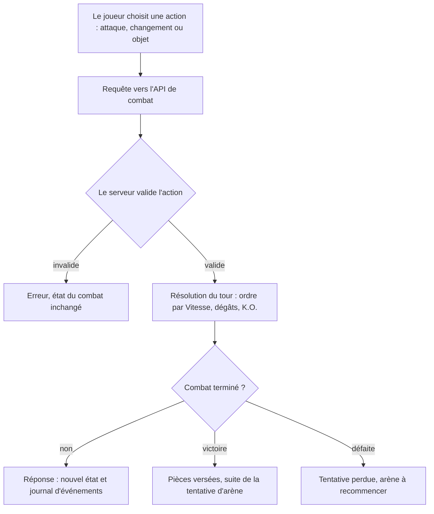
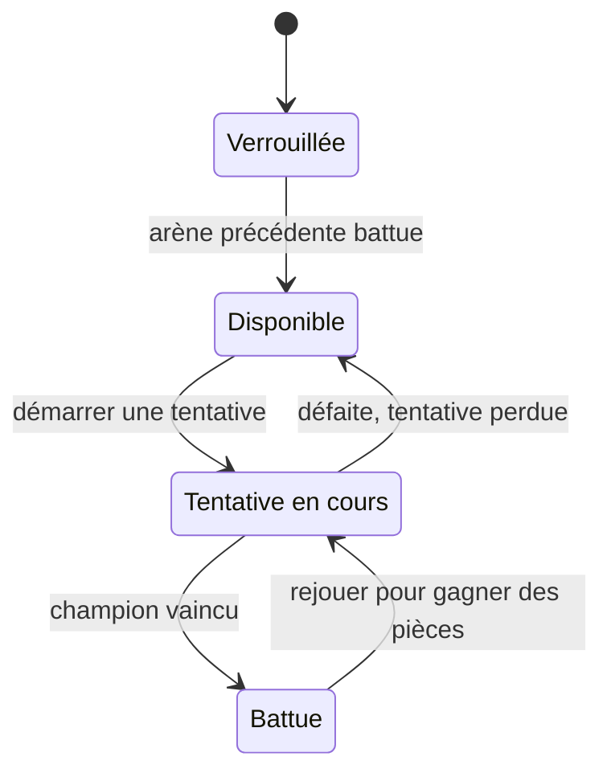
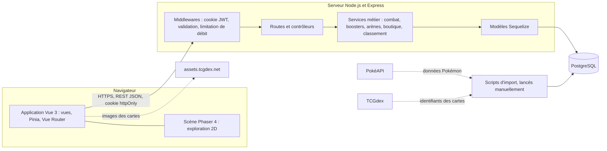
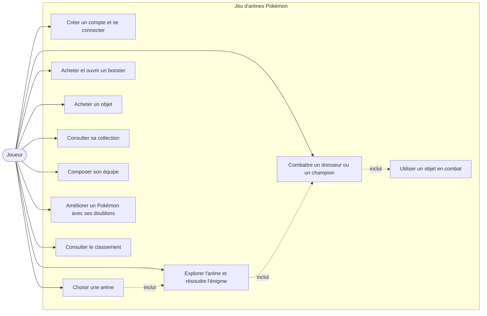
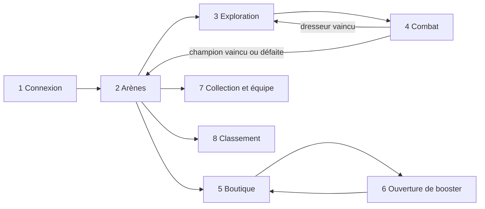
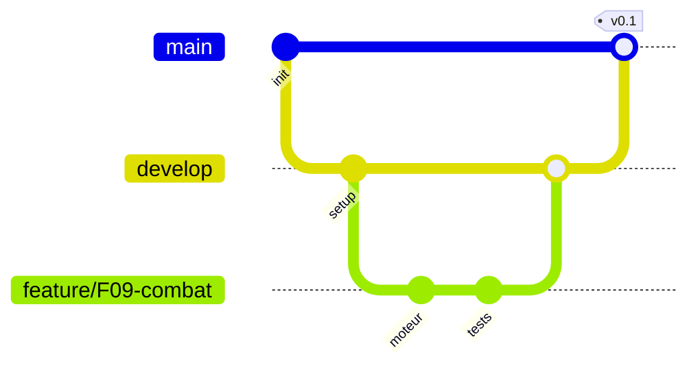

# Jeu d'arènes Pokémon : Spécification technique

Version 0.1 (brouillon pour relecture) · 27 octobre 2026 · Rendu prévu le 8 novembre 2026

**Équipe** : Clémentin LY (front-end), Emi LIM (game design), Clément BAS (back-end et base de données)

**Documents liés** : [Dossier de cadrage](fiche-de-cadrage.md) · [Wireframes Figma](https://www.figma.com/design/ifk933rnzkzElYfMFhCt2N)

> **Comment lire ce document.** Ce document complète le dossier de cadrage : il ne le remplace pas. Les sections 1 à 3 en reprennent l'essentiel et renvoient vers lui pour le détail. Les décisions nouvelles, qui ne figurent pas dans le dossier de cadrage, sont marquées **[À VALIDER]** et regroupées dans la section 7.

## Sommaire

1. [Expression du besoin](#1-expression-du-besoin)
2. [Analyse des utilisateurs](#2-analyse-des-utilisateurs)
3. [État de l'art et positionnement](#3-état-de-lart-et-positionnement)
4. [Solutions possibles](#4-solutions-possibles)
5. [Solution retenue](#5-solution-retenue)
   - 5.1 [Fonctionnalités prévues](#51-fonctionnalités-prévues)
   - 5.2 [Règles de jeu et moteur de combat](#52-règles-de-jeu-et-moteur-de-combat)
   - 5.3 [Architecture logicielle](#53-architecture-logicielle)
   - 5.4 [Langages et librairies](#54-langages-et-librairies)
   - 5.5 [Modélisations du système](#55-modélisations-du-système)
   - 5.6 [Maquettes (wireframes)](#56-maquettes-wireframes)
   - 5.7 [Méthode d'organisation du travail](#57-méthode-dorganisation-du-travail)
   - 5.8 [Organisation du dépôt Git](#58-organisation-du-dépôt-git)
   - 5.9 [Qualité, sécurité et performance](#59-qualité-sécurité-et-performance)
6. [Risques](#6-risques)
7. [Points ouverts et décisions à valider](#7-points-ouverts-et-décisions-à-valider)
8. [Jalons](#8-jalons)
9. [Annexes](#9-annexes)

---

## 1. Expression du besoin

### 1.1 Contexte et problématique

Les jeux Pokémon de la série principale demandent plus de 30 heures de jeu, une longue phase d'exploration et une console. Beaucoup de fans, notamment ceux qui ont grandi avec les premiers jeux, n'ont plus le temps de s'y investir, tout en restant attachés à l'univers.

**Problématique** : il n'existe pas d'expérience Pokémon courte, accessible depuis un navigateur, qui permette de retrouver l'essentiel du plaisir de la série (combattre, collectionner, progresser) en quelques minutes par session.

### 1.2 Comment nous comptons y répondre

| Objectif du dossier de cadrage | Réponse apportée par le projet |
| --- | --- |
| Jouer en sessions courtes, sans console ni installation | Jeu web en 2D. Une arène se joue en quelques minutes. L'état de la partie est enregistré côté serveur, donc une session peut être interrompue et reprise. |
| Donner un sentiment de progression durable | 4 arènes à difficulté croissante avec déblocage strict, pièces, boosters, amélioration des Pokémon par doublons, classement. |
| Satisfaire les occasionnels et les joueurs en quête de défi | Difficulté graduée de facile à impossible, adversaires pilotés par une IA plus ou moins stratège selon l'arène, équipes de 6 Pokémon en arène impossible. |
| Valoriser la collection | Boosters de type et de rareté, cartes officielles du JCC révélées une par une, doublons utiles (amélioration), collection filtrable. |
| Se mesurer de façon équitable | Classement calculé par le serveur, combats sans hasard (voir 5.2), aucun achat avec de l'argent réel. |

### 1.3 Besoins fonctionnels et non fonctionnels

Les besoins fonctionnels sont détaillés en 5.1 (16 fonctionnalités). Les besoins non fonctionnels et leur traduction technique sont :

| Besoin | Traduction technique | Section |
| --- | --- | --- |
| Sécurité (progression et classement protégés contre la triche) | Le serveur calcule les pièces, les tirages, les combats et les déblocages. Le client n'envoie que des intentions. | 5.3, 5.9 |
| Performance (chargement en moins de 3 s, jeu fluide) | Découpage du code, moteur Phaser chargé uniquement à l'entrée d'une arène, images en WebP, compression HTTP, index en base. | 5.9 |
| Accessibilité (ordinateur et mobile) | Interface responsive, commandes tactiles, navigation clavier, textes lisibles. | 5.6, 5.9 |
| Maintenabilité (contenu facile à faire évoluer) | Pokémon, attaques, taux et arènes stockés en base et dans des fichiers de données, importés par des scripts. Aucune règle de contenu codée en dur. | 5.3, 5.8 |

### 1.4 Contraintes

- Jeu en 2D, jouable dans un navigateur.
- Projet non commercial et non publié. L'univers Pokémon et ses visuels appartiennent à Nintendo / The Pokémon Company : les images ne sont pas stockées dans le dépôt (voir 5.9).
- Délai court : la spécification est à rendre le 8 novembre 2026, et le développement vient ensuite.

---

## 2. Analyse des utilisateurs

Le dossier de cadrage décrit quatre personae. Le tableau ci-dessous en reprend l'essentiel et indique ce qu'ils imposent au produit.

| Persona | Profil | Ce qu'il attend | Conséquence sur la conception |
| --- | --- | --- | --- |
| **Lucas**, le nostalgique (cible principale) | 27 ans, développeur, a grandi avec Rouge et Bleu. Joue sur ordinateur, pendant les pauses. | Retrouver l'ambiance de la 1ʳᵉ génération, reprendre sa partie en quelques clics. | 151 Pokémon de la 1ʳᵉ génération. État de la tentative d'arène sauvegardé côté serveur pour reprendre après une interruption. |
| **Inès**, la compétitrice | 21 ans, étudiante en informatique. Joue longtemps, sur ordinateur. | Un vrai défi stratégique, un classement fiable. Déteste la chance qui décide de tout et la triche. | Combats sans hasard, IA exigeante en arène difficile et impossible, classement calculé par le serveur. |
| **Théo**, le collectionneur | 16 ans, lycéen. Joue sur téléphone, dans les transports. | Compléter sa collection, ouvrir des boosters, suivre ses doublons. | Ouverture de booster soignée, cartes JCC officielles, doublons utiles, interface mobile complète. |
| **Sarah**, la joueuse occasionnelle | 34 ans, infirmière. Joue 10 minutes le soir, sur téléphone. | Prise en main immédiate, progression qui ne bloque jamais. | Équipe de départ fournie, pièces gagnées même sans battre le champion, interface simple, commandes tactiles. |

**Exigences qui en découlent**

| Exigence | Personae | Où elle est traitée |
| --- | --- | --- |
| Sessions courtes, interruptibles et reprenables | Lucas, Sarah | F02, F06 (sauvegarde de l'état d'une tentative), 5.3 |
| Difficulté progressive avec un dernier défi exigeant | Sarah, Inès | F04, F08, F09, 5.2 (IA par difficulté) |
| Une progression qui ne bloque jamais | Sarah, Théo | F10 (pièces dès la première victoire), rejouer une arène battue |
| Collection valorisée, doublons compris | Théo | F14, F15 |
| Classement infalsifiable | Inès | F16, 5.9 (anti-triche) |
| Interface utilisable sur téléphone | Théo, Sarah | 5.6 (version mobile de chaque écran) |

---

## 3. État de l'art et positionnement

Le tableau détaillé des jeux étudiés (Pokémon Rouge et Bleu, JCC Pokémon Pocket, Pokémon GO, Pokémon Champions, Pokémon Showdown, PokéRogue) est dans le [dossier de cadrage, section 3](fiche-de-cadrage.md). En résumé :

| Brique | Qui la propose | Ce qui manque |
| --- | --- | --- |
| Progression par arènes | Jeux principaux (8 arènes), Pokémon GO | Aventure trop longue, console obligatoire, ou arènes sans difficulté graduée |
| Collection par boosters | JCC Pokémon Pocket | Pas de combats Pokémon, pas de progression par arènes |
| Combat dans le navigateur | Pokémon Showdown, PokéRogue | Pas de progression solo durable ni de collection (Showdown), roguelite sans collection durable (PokéRogue) |

**Notre positionnement.** Le projet réunit en une seule expérience courte ce que chaque jeu ne fait qu'en partie : la structure en arènes des jeux principaux, le plaisir de l'ouverture de booster du JCC, et la faisabilité technique prouvée par PokéRogue (un jeu Pokémon 2D complet tourne dans le navigateur avec Phaser).

**Enseignements retenus pour la conception**

1. La progression par arènes est connue de tous les fans : aucun tutoriel long n'est nécessaire.
2. L'ouverture de booster est le moment fort : animation et révélation de la rareté soignées (écran 6).
3. Les taux de chaque booster sont affichés dans la boutique avant l'achat (écran 5).
4. Bonnes pratiques empruntées aux jeux à tirage aléatoire : afficher les taux, limiter la frustration des doublons (ils servent à améliorer les Pokémon), ne jamais demander d'argent réel.

---

## 4. Solutions possibles

### 4.1 Solutions de concept

Le dossier de cadrage a comparé cinq concepts. La décision est inchangée : jeu d'arènes avec collection par boosters, limité à la 1ʳᵉ génération.

| Concept envisagé | Décision | Raison principale |
| --- | --- | --- |
| **Progression par arènes et collection par boosters (1ʳᵉ génération)** | **Retenu** | Faisable dans le délai, répond à tous les personae, combine deux briques qui n'existent pas ensemble. |
| Remake d'un jeu complet | Écarté | Trop de contenu (cartes, dialogues), copie directe de l'œuvre. |
| Roguelite inspiré de PokéRogue | Écarté | Concept déjà réalisé et très abouti. |
| Gestion d'arène (le joueur construit son arène) | Écarté, gardé comme évolution | Éditeur d'arène et équilibrage entre joueurs trop lourds. |
| Toutes générations | Écarté | Plus de 1 000 Pokémon à équilibrer, perte de l'identité 1ʳᵉ génération. |
| Jeu en 3D (ligne à compléter dans le dossier de cadrage) | Écarté | Trop lourd pour un jeu navigateur, et le projet reste en 2D. |

### 4.2 Solutions techniques comparées

Pour chaque décision technique, les options envisagées sont comparées. Le détail des versions est en 5.4.

| Décision | Options envisagées | Choix | Justification |
| --- | --- | --- | --- |
| Framework front-end | Vue 3, React, Svelte | **Vue 3 avec Vite** | Imposé par le dossier de cadrage. Bonne intégration de Pinia et Vue Router, et Phaser s'embarque simplement dans un composant Vue. |
| Moteur 2D pour l'exploration d'arène | Phaser, PixiJS, Canvas natif, DOM et CSS | **Phaser 4** | Gère cartes en tuiles, collisions, entrées clavier et tactiles, animations. Choix confirmé par PokéRogue, qui l'utilise. PixiJS et Canvas natif demanderaient de coder soi-même les cartes et collisions. |
| Affichage du combat | Phaser, Vue (DOM et CSS) | **Vue (DOM et CSS)** | Le combat est surtout de l'interface (barres de PV, menus, journal), pas du déplacement. Plus simple à rendre responsive et accessible. Les animations sont en CSS. |
| Back-end | Express, Fastify, NestJS | **Express** | Imposé par le dossier de cadrage, simple à prendre en main, très documenté. |
| Base de données | PostgreSQL, MySQL, MongoDB | **PostgreSQL** | Choix de l'équipe. Données fortement relationnelles (collections, arènes, classement) et transactions fiables pour les achats. |
| ORM | Sequelize, Prisma, requêtes SQL directes | **Sequelize 6** | Choix de l'équipe. La version 6 est la version stable (la 7 est encore en alpha). |
| Authentification | JWT en cookie httpOnly, session serveur, JWT en localStorage | **JWT en cookie httpOnly** | Choix de l'équipe (JWT). Le cookie httpOnly protège le jeton contre le vol par script (XSS), contrairement à localStorage. |
| Communication client et serveur | REST, WebSocket, GraphQL | **REST en JSON** | Combats au tour par tour et solo : une requête par action suffit. Pas de temps réel nécessaire. |
| Source des données Pokémon | PokéAPI importée en base, fichier saisi à la main, appels à PokéAPI en cours de jeu | **PokéAPI importée une seule fois en base** | PokéAPI demande de mettre ses ressources en cache. On l'interroge uniquement lors d'un script d'import. Le jeu ne dépend plus d'elle ensuite. |
| Cartes du JCC | TCGdex, stockage local des images | **TCGdex, images chargées depuis son CDN** | Aucune image dans le dépôt. L'URL d'une carte se reconstruit à partir de son identifiant. |
| Cartes des arènes | Éditeur Tiled (JSON), format maison | **Tiled** | Éditeur gratuit, export JSON lu directement par Phaser. Permet à Emi de concevoir les arènes sans coder. |
| Simulation du combat | Calcul côté client, calcul côté serveur | **Côté serveur, état enregistré en base** | Obligatoire pour la sécurité. L'état enregistré permet aussi de reprendre un combat interrompu. |
| Hébergement | Local avec Docker, hébergeur cloud | **Local avec Docker Compose** | Projet non publié. Un hébergeur pourra être ajouté plus tard sans changer l'architecture. |

---

## 5. Solution retenue

### 5.1 Fonctionnalités prévues

Les 16 fonctionnalités de la version 1 (MVP) reprennent celles du dossier de cadrage. Chacune est reliée à un écran des wireframes (section 5.6) et à un jalon (section 8).

| ID | Fonctionnalité | Personae | Écran | Jalon | Critère d'acceptation |
| --- | --- | --- | --- | --- | --- |
| F01 | Inscription et connexion | Tous | 1 | J1 | Un joueur crée un compte (pseudo, e-mail, mot de passe), se connecte et se déconnecte. Le mot de passe est haché. La session persiste après fermeture du navigateur. |
| F02 | Sauvegarde de la progression | Lucas, Sarah | Tous | J1 | Pièces, collection, doublons, inventaire, équipe, arènes battues et tentative en cours sont stockés côté serveur et retrouvés sur un autre appareil. |
| F03 | Équipe de départ | Sarah, Lucas | 7 | J1 | À la première connexion, le joueur reçoit une équipe suffisante pour battre l'arène 1 (composition à définir, voir 7). |
| F04 | Sélection des arènes | Tous | 2 | J4 | Une arène affichée à la fois avec flèches gauche et droite. Statut visible : verrouillée, disponible ou battue. |
| F05 | Déblocage progressif | Inès, Sarah | 2 | J4 | Le serveur refuse l'entrée dans une arène dont la précédente n'est pas battue. |
| F06 | Exploration de l'arène | Lucas | 3 | J4 | Déplacement case par case au clavier ou au toucher, collisions avec les murs et obstacles. Les dresseurs déjà battus et l'énigme déjà résolue le restent après un rechargement. |
| F07 | Énigme d'arène | Lucas, Inès | 3 | J4 | Une énigme par arène (rochers à pousser, interrupteurs) ferme la porte du champion tant qu'elle n'est pas résolue. |
| F08 | Combats de dresseurs | Inès, Lucas | 3, 4 | J3 | 2 à 3 dresseurs sur le chemin. Un combat se déclenche quand le joueur passe devant eux. 1 à 6 Pokémon par dresseur (6 en arène impossible). |
| F09 | Combat contre le champion | Inès | 4 | J3 | Combat au tour par tour contre 6 Pokémon : attaque, changement de Pokémon, objet. Efficacité des types appliquée. Résultat calculé par le serveur. |
| F10 | Récompenses | Sarah, Théo | 4 | J3 | Pièces à chaque combat gagné : peu pour un dresseur, beaucoup pour un champion, plus la première fois. |
| F11 | Boutique de boosters | Théo | 5 | J2 | Boosters de rareté et de type, prix croissant pour les raretés. Tous les taux sont affichés avant l'achat. |
| F12 | Ouverture de booster | Théo | 6 | J2 | Le serveur tire 6 Pokémon à l'achat. Le client les révèle un par un sous forme de cartes JCC officielles. Les doublons sont signalés. |
| F13 | Boutique d'objets | Inès, Sarah | 5 | J2 | Achat de potions, rappels et soins de statut avec les pièces. Les objets vont dans l'inventaire. |
| F14 | Collection, inventaire et équipe | Théo, Inès | 7 | J2 | Liste des Pokémon possédés avec doublons, filtres par type et rareté, objets, composition de l'équipe de 6. |
| F15 | Amélioration par doublons | Théo | 7 | J2 | Tous les 10 doublons, une amélioration de +5 % des stats de base. 5 améliorations au maximum. Le serveur vérifie les conditions. |
| F16 | Classement | Inès | 8 | J5 | Joueurs classés par arène la plus haute battue, départagés par la date d'obtention. |

**Évolutions envisagées** (hors version 1) : Pokédex, conversion des doublons au-delà de 50, gestion des défaites, règles spécifiques de l'arène impossible, classements secondaires, profil joueur. Voir le dossier de cadrage, section 5.

### 5.2 Règles de jeu et moteur de combat

Cette section transforme les règles du dossier de cadrage en règles exécutables par le serveur. Les valeurs chiffrées marquées « initiales » seront ajustées par Emi pendant l'équilibrage.

#### Statistiques

La rareté fixe un indice de puissance. Cet indice est réparti entre les 5 stats selon le profil réel du Pokémon.

| Rareté | Indice de base | Après 5 améliorations | Palier suivant sans amélioration |
| --- | --- | --- | --- |
| Commun | 100 | 125 | 160 |
| Rare | 160 | 200 | 250 |
| Épique | 250 | 312 | 380 |
| Légendaire | 380 | 475 | aucun |

- **Répartition** : `stat = arrondi(indice × stat_de_base_du_Pokémon / total_des_stats_de_base)`, pour PV, Attaque, Défense, Spécial et Vitesse. Pour le Spécial, nous utilisons la moyenne de l'Attaque spéciale et de la Défense spéciale de PokéAPI. **[À VALIDER]**
- **Amélioration** : chaque niveau ajoute 5 % de l'indice de base. Stats = valeurs de base × (1 + 0,05 × niveau d'amélioration). Cette formule reproduit exactement le tableau du dossier de cadrage (100 donne 125, 250 donne 312).
- **Coût d'une amélioration** : 10 doublons, qui sont consommés. Cinq améliorations coûtent donc 50 doublons au total, comme dans le dossier de cadrage. **[À VALIDER]**

La règle d'écart (un Pokémon amélioré 5 fois reste sous le palier suivant non amélioré) est vérifiée par un test automatique sur les données importées.

#### Combat

Le combat est calculé entièrement par le serveur, au tour par tour. Les règles suivantes sont proposées. **[À VALIDER]**

| Règle | Proposition | Raison |
| --- | --- | --- |
| Hasard | Aucun : pas de coups critiques, pas d'attaques ratées, dégâts sans variation aléatoire. | Inès rejette un jeu où « la chance décide de tout ». Un combat sans hasard est aussi reproductible, donc testable. Seul le tirage des boosters est aléatoire. |
| Ordre des actions | Le Pokémon le plus rapide agit en premier. En cas d'égalité, le joueur agit en premier. Changer de Pokémon ou utiliser un objet passe avant les attaques. | Règle simple et lisible. |
| Dégâts | `dégâts = max(1, arrondi(puissance × attaque / défense × KDMG × STAB × efficacité))`. Une attaque physique utilise Attaque contre Défense, une attaque spéciale utilise Spécial contre Spécial. | Formule inspirée de la 1ʳᵉ génération. |
| Paramètres initiaux | `PV_max = arrondi(stat_PV × KPV)` avec KPV = 4 et KDMG = 0,3. | À calibrer par simulation de combats automatiques. |
| Catégorie d'une attaque | Déterminée par son type, comme en 1ʳᵉ génération : Normal, Combat, Vol, Poison, Sol, Roche, Insecte et Spectre sont physiques. Feu, Eau, Plante, Électrik, Psy, Glace et Dragon sont spéciaux. | Évite de stocker une catégorie par attaque. |
| STAB | Multiplicateur de 1,5 si le type de l'attaque est celui du Pokémon. | Valorise le type des Pokémon. |
| Efficacité des types | Table d'efficacité de la 1ʳᵉ génération (15 types, sans Acier, Ténèbres ni Fée), importée depuis PokéAPI, qui fournit les relations d'avant les types ajoutés plus tard (`past_damage_relations`). Les Pokémon dont le type a changé depuis (par exemple Mélofée) sont importés avec leur type d'origine. Importer ces corrections est à vérifier lors de J0. | Source fiable, pas de saisie manuelle. |
| Attaques | 4 attaques par Pokémon, définies en base lors de l'import. Pas de précision, pas de PP. | Réduit la complexité. Voir le point 5 de la section 7. |
| Objets | Potion (rend des PV), rappel (relève un Pokémon K.O.), soin de statut. | Reprend la boutique d'objets du dossier de cadrage. |
| Intelligence des adversaires | Facile : attaque au hasard. Normale : attaque qui fait le plus de dégâts. Difficile : en plus, change de Pokémon en cas de désavantage de type. Impossible : en plus, utilise des objets. | Fait monter la difficulté sans tricher sur les stats. |
| Victoire et défaite | Victoire quand tous les Pokémon adverses sont K.O. Défaite quand tous les Pokémon du joueur sont K.O. Une défaite contre n'importe quel adversaire (dresseur ou champion) fait perdre l'arène : la tentative est terminée et le joueur recommence tous les combats depuis le début. | Règle du dossier de cadrage. |

Un tour est traité ainsi : le client envoie une action, le serveur la valide, calcule le tour, enregistre le nouvel état du combat en base, puis renvoie le nouvel état et un **journal d'événements** que le client n'a qu'à animer.



#### Boosters

- **Taux stockés en points de base** : 10 000 points = 100 %. Salamèche à 7 % vaut donc 700, Dracaufeu à 1 % vaut 100, et un légendaire à environ 0,3 % vaut environ 30. Cela évite les erreurs d'arrondi : un test automatique vérifie que la somme de chaque booster fait exactement 10 000.
- **Tirage** : à l'achat, le serveur effectue 6 tirages indépendants avec un générateur aléatoire sécurisé (`crypto.randomInt` de Node.js), en tenant compte des taux du booster. Le débit des pièces, le tirage et l'ajout à la collection se font dans **une seule transaction** de base de données.
- **Doublons** : un Pokémon déjà possédé ajoute 1 doublon. La première copie ne compte pas comme doublon.
- **Taux des boosters de type** : définis par Emi dans un fichier de données (`server/data/booster-rates.json`) importé en base. Cela respecte la règle du dossier de cadrage (taux plus faible pour les formes évoluées, légendaires du type à environ 0,3 %).
- **Boosters de rareté** : comme il n'y a que 16 communs et 5 légendaires, la composition exacte est à fixer. Voir le point 2 de la section 7.

#### Configuration d'une arène

Une arène est décrite par des données, pas par du code : la carte vient d'un fichier Tiled, le reste d'un fichier JSON importé en base. Exemple (les valeurs de récompense sont fictives) :

```json
{
  "position": 2,
  "name": "Arène Normale",
  "difficulty": "normale",
  "mapKey": "arene-02",
  "puzzle": { "type": "rochers" },
  "trainers": [
    {
      "name": "Dresseur 1",
      "aiProfile": "gloutonne",
      "rewardFirst": 40,
      "rewardRepeat": 10,
      "team": [ { "pokemonId": 19, "upgradeLevel": 0 } ]
    },
    {
      "name": "Champion",
      "isChampion": true,
      "aiProfile": "gloutonne",
      "rewardFirst": 200,
      "rewardRepeat": 40,
      "team": [
        { "pokemonId": 143, "upgradeLevel": 2 },
        { "pokemonId": 128, "upgradeLevel": 2 }
      ]
    }
  ]
}
```

#### Tentative d'arène et reprise

Chaque entrée dans une arène crée une **tentative** (`arena_runs`). Le serveur y enregistre l'énigme résolue et les dresseurs vaincus. Il enregistre aussi l'état du combat en cours. Une défaite contre n'importe quel adversaire termine la tentative : le joueur en recommence une, depuis le début, comme le prévoit le dossier de cadrage. Si le joueur ferme son navigateur, il retrouve sa tentative à la dernière étape enregistrée (dernier combat terminé ou énigme résolue) et son combat en cours est repris tel quel. Sa position exacte sur la carte n'est pas conservée.



### 5.3 Architecture logicielle

#### Vue d'ensemble

Architecture classique en trois niveaux : une application Vue dans le navigateur, une API Express, une base PostgreSQL. Le principe directeur est : **le client affiche, le serveur décide**.



#### Qui décide quoi

| Élément | Décidé par | Détail |
| --- | --- | --- |
| Pièces gagnées et dépensées | Serveur | Chaque mouvement est enregistré dans `coin_transactions`. |
| Tirage des boosters | Serveur | Réalisé à l'achat, dans une transaction. Le client ne fait que révéler. |
| Résultat des combats | Serveur | Le client envoie une action, le serveur renvoie le résultat. |
| Déblocage des arènes | Serveur | Vérifié à chaque démarrage de tentative. |
| Amélioration des Pokémon | Serveur | Vérifie le nombre de doublons et le niveau maximal. |
| Classement | Serveur | Calculé par une requête SQL, jamais envoyé par le client. |
| Déplacement du joueur, animations | Client | Aucun enjeu de triche. |
| Énigme de l'arène | Client en version 1 | Voir le point 8 de la section 7. Le serveur impose quand même de battre tous les dresseurs avant le champion. |

#### Interface de programmation (API REST)

Toutes les routes sont préfixées par `/api`. Toutes, sauf l'inscription et la connexion, exigent un joueur connecté.

| Domaine | Méthode et route | Rôle |
| --- | --- | --- |
| Authentification | `POST /auth/register` | Créer un compte (pseudo, e-mail, mot de passe) |
| | `POST /auth/login` | Se connecter, pose le cookie |
| | `POST /auth/logout` | Se déconnecter, supprime le cookie |
| | `GET /auth/me` | Joueur courant : pseudo, pièces, équipe |
| Arènes | `GET /arenas` | Liste des 4 arènes avec le statut pour le joueur |
| | `GET /arenas/:id` | Détail d'une arène (adversaires, récompenses) |
| | `POST /arenas/:id/runs` | Démarrer une tentative (refusé si verrouillée) |
| | `GET /runs/current` | Reprendre la tentative en cours |
| | `POST /runs/:id/puzzle` | Déclarer l'énigme résolue |
| Combats | `POST /runs/:id/battles` | Engager un dresseur ou le champion |
| | `GET /battles/:id` | État du combat (reprise) |
| | `POST /battles/:id/actions` | Jouer un tour : attaque, changement ou objet |
| Boutique | `GET /shop/boosters` | Boosters avec prix et taux |
| | `POST /shop/boosters/:id/purchase` | Acheter et ouvrir un booster (renvoie les 6 Pokémon) |
| | `GET /shop/items` | Objets et prix |
| | `POST /shop/items/:id/purchase` | Acheter un objet |
| Collection | `GET /collection` | Pokémon possédés, doublons, niveaux |
| | `POST /collection/:pokemonId/upgrade` | Améliorer un Pokémon |
| | `PUT /team` | Définir l'équipe de 6 |
| | `GET /inventory` | Objets possédés |
| Classement | `GET /leaderboard` | Classement paginé et rang du joueur |

Les erreurs ont un format unique, par exemple :

```json
{ "error": { "code": "ARENE_VERROUILLEE", "message": "Battez l'arène précédente pour accéder à celle-ci." } }
```

#### Organisation du front-end

| Élément | Rôle |
| --- | --- |
| Vues (une par écran) | `LoginView`, `ArenasView`, `ArenaExploreView`, `BattleView`, `ShopView`, `BoosterOpeningView`, `CollectionView`, `LeaderboardView` |
| Stores Pinia | `auth`, `player`, `arenas`, `run`, `battle`, `shop`, `collection` : un store par domaine, alimenté par l'API |
| Service API | Un module unique qui enveloppe `fetch` : gestion des erreurs, du cookie et du format d'erreur commun |
| Composant `PhaserGame.vue` | Monte et détruit proprement le jeu Phaser quand on entre ou sort d'une arène |
| Scène Phaser `ArenaScene` | Lit la carte Tiled, gère déplacement, collisions, rochers, interrupteurs, porte, dresseurs. Lit la tentative en cours pour savoir quels dresseurs sont déjà battus et si l'énigme est résolue |
| Lien Vue et Phaser | Quand le joueur passe devant un dresseur, la scène émet un événement. Vue demande le combat à l'API puis affiche `BattleView`. À la fin du combat, on revient à l'exploration avec l'état mis à jour |

#### Authentification

1. À la connexion, le serveur vérifie le mot de passe haché, puis émet un jeton JWT d'une durée de 7 jours.
2. Le jeton est posé dans un cookie `httpOnly`, `Secure` en production, `SameSite=Lax`. Le JavaScript du navigateur ne peut pas le lire.
3. Chaque requête porte le cookie. Un middleware le vérifie et charge le joueur.
4. En développement, Vite redirige `/api` vers le serveur (proxy). En production, Express sert directement le front compilé : tout est sur la même origine, donc pas de problème de CORS ni de cookie tiers.

### 5.4 Langages et librairies

Versions vérifiées le 27 octobre 2026.

| Domaine | Technologie | Version | Rôle et justification |
| --- | --- | --- | --- |
| Langage | JavaScript (modules ES) | | Pas de phase d'apprentissage supplémentaire dans un délai court. TypeScript reste possible. **[À VALIDER]** |
| Environnement serveur | Node.js | 24 LTS | Version à support long. La version 26 passe en support long le 28 octobre 2026 et pourra la remplacer. |
| Framework front | Vue 3 | 3.5 | Imposé par le dossier de cadrage |
| Outil de build | Vite | 8 | Recommandé par l'équipe Vue, développement rapide, découpage du code |
| Navigation | Vue Router | dernière stable | Une route par écran, garde de navigation pour les pages réservées aux joueurs connectés |
| État partagé | Pinia | dernière stable | Store officiel de Vue |
| Moteur 2D | Phaser | 4.x | Version majeure stable depuis avril 2026. Si une difficulté bloquante apparaît, la 3.90 reste un repli. |
| Cartes d'arènes | Tiled | | Éditeur de cartes gratuit, export JSON |
| Framework serveur | Express | dernière stable | Imposé par le dossier de cadrage |
| Base de données | PostgreSQL | 16 ou plus | Relationnel, transactions |
| ORM et migrations | Sequelize et sequelize-cli | 6.x | Modèles, associations, migrations versionnées |
| Authentification | `jsonwebtoken`, `bcrypt`, `cookie-parser` | | JWT, hachage des mots de passe, lecture du cookie |
| Validation des entrées | `zod` | | Schémas de validation pour chaque route |
| Protection | `helmet`, `express-rate-limit` | | En-têtes de sécurité, limitation des tentatives de connexion |
| Journalisation | `pino` | | Logs structurés |
| Import des données | `@tcgdex/sdk` et appels HTTP à PokéAPI | | Utilisés uniquement dans les scripts d'import |
| Tests | Vitest, Vue Test Utils, Supertest | | Mêmes outils des deux côtés, tests d'API avec Supertest |
| Qualité du code | ESLint et Prettier | | Style commun, vérifié en intégration continue |
| Environnement local | Docker Compose | | Lance PostgreSQL sans installation |
| Intégration continue | GitHub Actions | | Lint et tests à chaque pull request |

### 5.5 Modélisations du système

Les diagrammes sont écrits en Mermaid : GitHub les affiche directement. Les diagrammes d'architecture, de combat et de cycle d'une arène sont aux sections 5.3 et 5.2.

#### Cas d'utilisation



#### Navigation entre les écrans



#### Modèle de données

La base contient 21 tables. Les noms sont en anglais pour rester cohérents avec le code.

```mermaid
erDiagram
    USERS ||--o{ PLAYER_POKEMON : "possède"
    POKEMON ||--o{ PLAYER_POKEMON : "est possédé"
    USERS ||--o{ PLAYER_ITEMS : "possède"
    ITEMS ||--o{ PLAYER_ITEMS : "est possédé"
    POKEMON ||--o{ POKEMON_TYPES : "a pour type"
    TYPES ||--o{ POKEMON_TYPES : "qualifie"
    POKEMON ||--o{ POKEMON_MOVES : "connaît"
    MOVES ||--o{ POKEMON_MOVES : "est connue"
    TYPES ||--o{ MOVES : "type de l'attaque"
    TYPES ||--o{ TYPE_EFFECTIVENESS : "attaque"
    BOOSTERS ||--o{ BOOSTER_RATES : "contient"
    POKEMON ||--o{ BOOSTER_RATES : "taux de tirage"
    ARENAS ||--o{ TRAINERS : "compte"
    TRAINERS ||--o{ TRAINER_POKEMON : "aligne"
    POKEMON ||--o{ TRAINER_POKEMON : "est aligné"
    USERS ||--o{ PLAYER_ARENA_PROGRESS : "progresse"
    ARENAS ||--o{ PLAYER_ARENA_PROGRESS : "est battue"
    USERS ||--o{ ARENA_RUNS : "tente"
    ARENAS ||--o{ ARENA_RUNS : "est tentée"
    ARENA_RUNS ||--o{ RUN_VICTORIES : "enregistre"
    TRAINERS ||--o{ RUN_VICTORIES : "est vaincu"
    USERS ||--o{ PLAYER_TRAINER_VICTORIES : "a vaincu"
    TRAINERS ||--o{ PLAYER_TRAINER_VICTORIES : "a été vaincu"
    ARENA_RUNS ||--o{ BATTLES : "contient"
    TRAINERS ||--o{ BATTLES : "affronté"
    USERS ||--o{ COIN_TRANSACTIONS : "mouvements"

    USERS {
        int id PK
        string pseudo UK
        string email UK
        string password_hash
        int coins
        datetime created_at
    }
    POKEMON {
        int id PK "numéro du Pokédex"
        string name_fr
        string rarity
        int hp
        int attack
        int defense
        int special
        int speed
        string sprite_url
        string tcgdex_card_id
    }
    TYPES {
        int id PK
        string name_fr
    }
    POKEMON_TYPES {
        int pokemon_id PK
        int type_id PK
        int slot
    }
    MOVES {
        int id PK
        string name_fr
        int type_id FK
        int power
    }
    POKEMON_MOVES {
        int pokemon_id PK
        int move_id PK
    }
    TYPE_EFFECTIVENESS {
        int attacker_type_id PK
        int defender_type_id PK
        decimal multiplier
    }
    PLAYER_POKEMON {
        int user_id PK
        int pokemon_id PK
        int duplicates
        int upgrade_level
        int team_slot "vide si hors équipe"
    }
    BOOSTERS {
        int id PK
        string kind "rareté ou type"
        string name
        int price
    }
    BOOSTER_RATES {
        int booster_id PK
        int pokemon_id PK
        int rate_bp "points de base sur 10000"
    }
    ITEMS {
        int id PK
        string name_fr
        string effect
        int price
    }
    PLAYER_ITEMS {
        int user_id PK
        int item_id PK
        int quantity
    }
    ARENAS {
        int id PK
        int position UK
        string name
        string difficulty
        string map_key
        json puzzle_config
    }
    TRAINERS {
        int id PK
        int arena_id FK
        int position
        string name
        boolean is_champion
        string ai_profile
        int reward_first
        int reward_repeat
    }
    TRAINER_POKEMON {
        int trainer_id PK
        int slot PK
        int pokemon_id FK
        int upgrade_level
    }
    PLAYER_ARENA_PROGRESS {
        int user_id PK
        int arena_id PK
        datetime completed_at
    }
    ARENA_RUNS {
        int id PK
        int user_id FK
        int arena_id FK
        string status
        boolean puzzle_solved
        datetime started_at
    }
    RUN_VICTORIES {
        int run_id PK
        int trainer_id PK
    }
    PLAYER_TRAINER_VICTORIES {
        int user_id PK
        int trainer_id PK
        datetime first_won_at
    }
    BATTLES {
        int id PK
        int run_id FK
        int trainer_id FK
        string status
        int turn
        json state
    }
    COIN_TRANSACTIONS {
        int id PK
        int user_id FK
        int amount
        string reason
        datetime created_at
    }
```



**Points de conception du modèle**

- `PLAYER_POKEMON` n'a qu'une ligne par Pokémon possédé : le nombre de doublons et le niveau d'amélioration y sont stockés. La place dans l'équipe (`team_slot`, de 1 à 6) est unique par joueur.
- `BOOSTER_RATES` sert à la fois au tirage et à l'affichage des taux dans la boutique : la même source garantit que ce qui est affiché est ce qui est tiré.
- `PLAYER_TRAINER_VICTORIES` permet de savoir si une victoire est la première contre un adversaire, donc si la récompense majorée s'applique.
- `PLAYER_ARENA_PROGRESS` alimente le classement : arène la plus haute battue, puis la date de victoire la plus ancienne en cas d'égalité.
- `COIN_TRANSACTIONS` garde l'historique de tous les mouvements de pièces, ce qui permet d'auditer et de détecter une anomalie.
- `BATTLES.state` stocke l'état complet d'un combat (PV, Pokémon actif, tour) au format JSON pour pouvoir reprendre.

### 5.6 Maquettes (wireframes)

Les maquettes sont des wireframes en noir et blanc, en version ordinateur (1280 × 800) et mobile (390 × 844). Elles sont dans Figma : [fichier « Pokémon Arènes - Wireframes »](https://www.figma.com/design/ifk933rnzkzElYfMFhCt2N).

| Écran | Fonctionnalités | Versions |
| --- | --- | --- |
| 1. Connexion et inscription | F01 | Ordinateur et mobile |
| 2. Sélection des arènes | F04, F05 | Ordinateur et mobile |
| 3. Exploration d'une arène | F06, F07, F08 | Ordinateur et mobile (avec croix directionnelle) |
| 4. Combat au tour par tour | F08, F09, F10 | Ordinateur et mobile |
| 5. Boutique (boosters de type affichés) | F11, F13 | Ordinateur et mobile |
| 6. Ouverture de booster | F12 | Ordinateur et mobile |
| 7. Collection, équipe et inventaire | F14, F15 | Ordinateur et mobile |
| 8. Classement | F16 | Ordinateur et mobile |


**Ce que les maquettes ne montrent pas encore**

- Les onglets « Boosters de rareté » et « Objets » de la boutique, et les onglets « Équipe » et « Objets » de la collection mobile, sont visibles mais n'ont pas leur propre écran.
- Les valeurs « xx pièces », « PV xx / xx » et « Type : à définir » sont des emplacements : elles dépendent des points ouverts de la section 7.
- Les boutons « Retour aux arènes » (exploration) et « Terminer » (fin d'ouverture de booster) sont des ajouts par rapport au dossier de cadrage.
- Les pseudos, dates et noms du classement et de la collection sont des exemples.

### 5.7 Méthode d'organisation du travail

#### Rôles

| Personne | Rôle principal | Responsabilités |
| --- | --- | --- |
| **Clémentin LY** | Front-end | Application Vue, navigation, stores, intégration des wireframes, scène Phaser d'exploration, interface de combat et d'ouverture de booster, responsive et accessibilité |
| **Emi LIM** | Game design | Règles et équilibrage (stats par rareté, taux des boosters, prix, récompenses), choix des attaques, composition des arènes et des équipes adverses, comportement des IA, conception des cartes Tiled et des énigmes, tests de jeu |
| **Clément BAS** | Back-end et base de données | API, modèles et migrations Sequelize, scripts d'import (PokéAPI, TCGdex), moteur de combat, boosters, sécurité, Docker et intégration continue |

**Responsabilités partagées**

- **Contrat d'API** : Clémentin et Clément le rédigent ensemble avant de coder les écrans. Le tableau de la section 5.3 en est la base.
- **Règles du moteur de combat** : Emi définit les règles, Clément les implémente, et Emi valide le comportement par des combats de test.
- **Revue de code croisée** : chaque pull request est relue par quelqu'un d'un autre rôle.

#### Méthode : Kanban léger avec point hebdomadaire **[À VALIDER]**

| Élément | Règle |
| --- | --- |
| Outil | GitHub Projects, un tableau pour tout le projet |
| Colonnes | Backlog, À faire, En cours, En revue, Terminé |
| Tâches | Une *issue* GitHub par tâche, reliée à une fonctionnalité (F01 à F16) et à un jalon (J0 à J5) |
| Limite en cours | 2 tâches « En cours » au maximum par personne |
| Point d'équipe | 15 minutes par semaine en visio, pour avancer sur les blocages et ajuster les priorités. Le reste de la communication est écrite, sur les issues et pull requests. |
| Démonstration | À chaque fin de jalon, la version est lancée en local et testée ensemble |
| Journal des décisions | Fichier `docs/decisions.md` : chaque décision de conception est notée avec la date et la raison |

**Pourquoi Kanban plutôt que Scrum** : l'équipe est de trois personnes avec des disponibilités irrégulières. Des sprints fixes avec cérémonies seraient lourds. Un tableau Kanban avec des jalons garde la visibilité sans imposer de rythme rigide.

**Définition de « Terminé »** : le code est fusionné dans `develop` après revue, les tests passent en intégration continue, la fonctionnalité a été essayée dans le navigateur (ordinateur et mobile), et la documentation concernée est à jour.

**Étiquettes des issues** : `front`, `back`, `game-design`, `bug`, `docs`, `priorité-haute`.

### 5.8 Organisation du dépôt Git

#### Structure du dépôt

Un seul dépôt GitHub (monorepo), avec des espaces de travail npm pour le client et le serveur.

```text
pokemon-arenes/
├─ client/                    Application Vue
│  ├─ src/
│  │  ├─ assets/              Images et styles
│  │  ├─ components/          Composants réutilisables
│  │  ├─ views/               Un fichier par écran
│  │  ├─ stores/              Stores Pinia
│  │  ├─ router/              Routes et gardes
│  │  ├─ services/            Appels à l'API
│  │  └─ game/                Scène Phaser : scenes, entities, maps
│  ├─ public/
│  └─ tests/
├─ server/                    API Express
│  ├─ src/
│  │  ├─ config/              Configuration, connexion à la base
│  │  ├─ models/              Modèles Sequelize
│  │  ├─ migrations/          Migrations de la base
│  │  ├─ routes/              Définition des routes
│  │  ├─ controllers/         Lecture de la requête, appel des services
│  │  ├─ services/            Règles métier : combat, boosters, arènes, boutique
│  │  ├─ middlewares/         Authentification, validation, erreurs
│  │  └─ utils/
│  ├─ scripts/                Import PokéAPI et TCGdex, import des arènes
│  ├─ data/                   booster-rates.json, arenes/*.json, cartes Tiled
│  └─ tests/
├─ docs/
│  ├─ fiche-de-cadrage.md
│  ├─ specification-technique.md
│  ├─ decisions.md
│  └─ wireframes/             Images exportées de Figma
├─ .github/
│  ├─ workflows/ci.yml
│  └─ pull_request_template.md
├─ docker-compose.yml         PostgreSQL pour le développement
├─ .env.example               Variables d'environnement, sans secret
├─ .gitignore
├─ .editorconfig
├─ package.json               Espaces de travail et scripts communs
└─ README.md                  Installation et lancement en 5 étapes
```

#### Stratégie de branches

| Branche | Rôle | Règles |
| --- | --- | --- |
| `main` | Version stable, une par jalon | Protégée. Reçoit uniquement des fusions de `develop` par pull request, avec une étiquette de version (`v0.1`, `v0.2`...). |
| `develop` | Intégration continue du travail | Protégée. Reçoit les fusions des branches de fonctionnalité par pull request. |
| `feature/F07-moteur-de-combat` | Une fonctionnalité ou une tâche | Créée depuis `develop`, nommée avec l'identifiant de la fonctionnalité. Supprimée après fusion. |
| `fix/...`, `docs/...` | Correction de bug, documentation | Même circuit que les branches de fonctionnalité. |



#### Règles de collaboration

- **Commits** : convention *Conventional Commits* : `feat:`, `fix:`, `docs:`, `refactor:`, `test:`, `chore:`. Exemple : `feat(combat): calcul des dégâts avec efficacité des types`.
- **Pull requests** : une pull request par fonctionnalité, avec le modèle du dépôt (ce qui change, comment tester, capture d'écran si l'interface change, fonctionnalité concernée). Fusion en *squash* pour garder un historique lisible.
- **Revue** : au moins une approbation d'un autre rôle et une intégration continue au vert avant fusion.
- **Protection** : pas de poussée directe sur `main` ni `develop`.
- **Secrets** : jamais dans le dépôt. `.env` est ignoré par Git, `.env.example` liste les variables attendues.

#### Fichiers d'infrastructure

`docker-compose.yml` (PostgreSQL pour le développement) :

```yaml
services:
  db:
    image: postgres:16
    environment:
      POSTGRES_USER: arenes
      POSTGRES_PASSWORD: arenes
      POSTGRES_DB: arenes
    ports:
      - "5432:5432"
    volumes:
      - db-data:/var/lib/postgresql/data
volumes:
  db-data:
```

`.github/workflows/ci.yml` (vérification à chaque pull request) :

```yaml
name: CI
on:
  pull_request:
  push:
    branches: [develop, main]
jobs:
  test:
    runs-on: ubuntu-latest
    services:
      postgres:
        image: postgres:16
        env:
          POSTGRES_USER: arenes
          POSTGRES_PASSWORD: arenes
          POSTGRES_DB: arenes_test
        ports: ["5432:5432"]
        options: >-
          --health-cmd "pg_isready -U arenes"
          --health-interval 5s --health-timeout 5s --health-retries 10
    steps:
      - uses: actions/checkout@v4
      - uses: actions/setup-node@v4
        with:
          node-version: 24
          cache: npm
      - run: npm ci
      - run: npm run lint
      - run: npm test
```

Scripts communs du `package.json` racine : `npm run dev` (lance client et serveur), `npm run lint`, `npm test`, `npm run db:migrate` (migrations), `npm run db:seed` (import PokéAPI, TCGdex et arènes).

### 5.9 Qualité, sécurité et performance

#### Sécurité et anti-triche

| Menace | Parade |
| --- | --- |
| Falsifier les pièces ou la collection | Le client n'envoie jamais de montant ni de résultat. Toute modification passe par une route qui vérifie les règles. Chaque mouvement de pièces est tracé. |
| Truquer un tirage de booster | Tirage côté serveur avec un générateur aléatoire sécurisé. Débit, tirage et ajout dans une seule transaction. |
| Forcer une victoire | Le combat est joué par le serveur, action par action. Le client ne transmet aucun résultat. |
| Sauter une arène | Le serveur refuse de démarrer une tentative si l'arène précédente n'est pas battue. |
| Sauter les dresseurs pour atteindre le champion | Le serveur refuse d'engager le champion tant que tous les dresseurs de la tentative ne sont pas vaincus. |
| Dépenser deux fois les mêmes pièces avec des requêtes simultanées | Verrouillage de la ligne du joueur (`SELECT ... FOR UPDATE`) pendant l'achat. |
| Vol de mot de passe en base | Mots de passe hachés avec bcrypt, coût 12. |
| Vol du jeton de session | Cookie `httpOnly`, `Secure` et `SameSite=Lax`. |
| Attaque par force brute sur la connexion | Limitation du nombre de tentatives par adresse IP. |
| Injection SQL | Requêtes paramétrées par Sequelize. Validation de toutes les entrées avec `zod`. |

**Données personnelles** : le projet ne stocke que le pseudo, l'e-mail et le mot de passe haché. Aucune autre donnée n'est collectée.

#### Performance (objectif : chargement en moins de 3 secondes)

- Découpage du code par route : le moteur Phaser n'est chargé qu'à l'entrée d'une arène.
- Images en WebP, cartes du JCC chargées en basse qualité dans les listes et en haute qualité à l'ouverture. La carte suivante d'un booster est préchargée pendant la révélation de la précédente.
- Compression HTTP et en-têtes de cache sur les fichiers statiques.
- Index en base sur les clés étrangères et sur les colonnes du classement.
- Mesure : audit Lighthouse à chaque jalon, sur ordinateur et sur mobile.

#### Accessibilité et responsive

- Chaque écran existe en version ordinateur et mobile (section 5.6).
- Commandes tactiles (croix directionnelle) en plus du clavier, zones tactiles d'au moins 44 pixels.
- Information jamais portée par la couleur seule (statuts d'arène avec texte, rareté avec étiquette).
- Contrastes suffisants, texte d'au moins 14 pixels. Animation d'ouverture des boosters réduite si le navigateur indique `prefers-reduced-motion`.

#### Tests

| Niveau | Outil | Ce qui est testé en priorité |
| --- | --- | --- |
| Unitaire serveur | Vitest | Moteur de combat (efficacité, ordre, dégâts, victoire), tirage des boosters, formule d'amélioration |
| Données | Vitest | Taux de chaque booster = 10 000 points, règle d'écart entre raretés, 15 types, 151 Pokémon importés |
| API | Vitest et Supertest | Droits d'accès, déblocage des arènes, achats, transactions |
| Interface | Vitest et Vue Test Utils | Stores, composants clés (cartes, barre de PV) |
| Manuel | Navigateur | Parcours complet sur ordinateur et téléphone à chaque jalon |

Un script de **simulation de combats** (le serveur jouant contre lui-même avec les IA) aidera Emi à calibrer les paramètres d'équilibrage.

#### Droits et contenu Pokémon

- Le projet est non commercial et non publié.
- Les données viennent de PokéAPI, importées une seule fois en base comme le demande sa politique d'utilisation (mise en cache locale).
- Les cartes du JCC sont chargées depuis le CDN de TCGdex, sans copie dans le dépôt.
- Les images des Pokémon (sprites) sont référencées par leur adresse, non stockées dans le dépôt. Pour les tuiles et personnages de l'exploration, nous privilégions des lots d'images libres de droits plutôt que des images Nintendo. **[À VALIDER]**

---

## 6. Risques

| Risque | Probabilité | Impact | Réponse |
| --- | --- | --- | --- |
| Délai très court (rendu le 8 novembre, départ de Clémentin le 31 octobre) | Élevée | Élevé | Spécification complète avant le départ. Développement découpé en jalons indépendants. Revue et validation des points ouverts par écrit. |
| Charge du front-end concentrée sur une seule personne (Vue, Phaser, animations) | Moyenne | Élevé | Combat et ouverture de booster en Vue (plus simple que Phaser). Emi prend en charge les cartes Tiled et les assets. Clément aide au front une fois l'API livrée. |
| Équilibrage du jeu insuffisant (combats trop faciles ou trop durs) | Élevée | Moyen | Paramètres dans des fichiers de données, script de simulation, tests de jeu à chaque jalon. |
| Carte TCGdex ou image manquante pour certains Pokémon | Moyenne | Faible | Le script d'import cherche une carte par Pokémon et signale ceux qui n'en ont pas. Image de remplacement dans l'interface. |
| PokéAPI indisponible lors de l'import | Faible | Faible | Import une seule fois, résultat enregistré dans un fichier du dépôt ou une sauvegarde de la base. |
| Triche malgré les protections | Faible | Moyen | Toute la logique sensible côté serveur, tests d'API sur les droits d'accès. |
| Phaser 4 moins documenté que Phaser 3 | Moyenne | Moyen | Guide de migration officiel. Repli possible sur Phaser 3.90 si besoin. |
| Code généré par IA de qualité inégale | Moyenne | Moyen | Revue de code croisée obligatoire, tests automatiques, lint en intégration continue. |
| Élargissement du périmètre | Moyenne | Moyen | Les évolutions du dossier de cadrage restent hors version 1 tant que la version 1 n'est pas livrée. |

---

## 7. Points ouverts et décisions à valider

Chaque point a une recommandation par défaut, pour ne pas bloquer le développement si personne ne tranche.

| # | Question | Recommandation | À décider par | Impact |
| --- | --- | --- | --- | --- |
| 1 | **Soin entre deux combats** : l'équipe est-elle soignée entre deux combats d'une même arène ? (question ouverte du dossier de cadrage) | Soin complet à l'entrée d'une arène, aucun soin entre les combats. Les potions et rappels servent à tenir jusqu'au champion. Cela donne un intérêt à la boutique d'objets et du poids aux choix en arène difficile. | Emi | Moteur de combat, équilibrage |
| 2 | **Composition d'un booster de rareté** (il n'y a que 16 communs et 5 légendaires) | Un booster d'une rareté tire uniquement des Pokémon de cette rareté, avec la même probabilité pour chacun. Le booster légendaire donne donc souvent des doublons : il doit coûter cher. | Emi | Boutique, taux |
| 3 | **Équipe de départ** | 3 Pokémon communs ou rares de types variés, suffisants pour battre l'arène 1. | Emi | F03, équilibrage de l'arène 1 |
| 4 | **Statuts** (le dossier de cadrage prévoit des soins de statut) | Liste minimale : poison, paralysie, sommeil. À fixer avant d'écrire le moteur de combat. | Emi, Clément | Moteur de combat |
| 5 | **Choix des 4 attaques par Pokémon** | Deux attaques du type du Pokémon et deux attaques d'un autre type, sélectionnées parmi les attaques de la 1ʳᵉ génération. Puissance régulée par la rareté. | Emi | Import des données, équilibrage |
| 6 | **Prix et récompenses** (boosters, objets, dresseurs, champions) | À calculer par Emi avec un tableur pour que l'arène 1 donne assez de pièces pour un premier booster. | Emi | Boucle de jeu |
| 7 | **Consommation des doublons** : améliorer consomme-t-il 10 doublons ? | Oui (5 niveaux = 50 doublons, comme dans le dossier de cadrage). | Équipe | F15, écran 7 |
| 8 | **Validation de l'énigme côté serveur** | Version 1 : le client déclare l'énigme résolue (le risque est faible car le serveur impose déjà de battre tous les dresseurs avant le champion). Version 2 : le client envoie la suite de déplacements et le serveur la rejoue. | Clément | Sécurité |
| 9 | **JavaScript ou TypeScript** | JavaScript avec ESLint, pour limiter le temps d'apprentissage. TypeScript reste envisageable si l'équipe y est à l'aise. | Équipe | Tout le code |
| 10 | **Méthode** : Kanban léger ou Scrum | Kanban léger (section 5.7). | Équipe | Organisation |
| 11 | **Comportement des IA d'adversaires** | Quatre profils (hasard, glouton, stratège, expert) selon la difficulté. Les règles exactes sont à préciser. | Emi | Moteur de combat |
| 12 | **Types d'énigmes** (une par arène) | Arène 1 : rochers. Arène 2 : interrupteurs. Arènes 3 et 4 : combinaison des deux ou mécanique nouvelle. | Emi | Cartes Tiled, scène Phaser |
| 13 | **Spécial** : moyenne de l'Attaque spéciale et de la Défense spéciale | Oui. | Emi | Import des données |
| 14 | **Source des visuels d'exploration** | Lots d'images libres de droits. | Équipe | Assets |

---

## 8. Jalons

Les dates sont à fixer en équipe. L'ordre tient compte des dépendances : chaque jalon livre quelque chose de jouable ou de démontrable.

| Jalon | Contenu | Fonctionnalités | Qui |
| --- | --- | --- | --- |
| **J0 : Fondations** | Dépôt, branches protégées, intégration continue, Docker, migrations, import des 151 Pokémon, des types, des attaques et des cartes TCGdex. Squelette Vue (navigation, stores). | | Clément, Clémentin |
| **J1 : Compte et sauvegarde** | Inscription, connexion, session persistante, équipe de départ, état du joueur. | F01, F02, F03 | Clément (API), Clémentin (écran 1) |
| **J2 : Collection et boutique** | Boutique de boosters et d'objets, tirage, ouverture animée, collection, équipe, amélioration par doublons. | F11 à F15 | Clément (API), Clémentin (écrans 5, 6, 7), Emi (taux, prix) |
| **J3 : Combat** | Moteur de combat serveur, interface de combat, récompenses. Premier combat jouable. | F08 (combat), F09, F10 | Clément (moteur), Clémentin (écran 4), Emi (règles, IA) |
| **J4 : Arènes** | Sélection, déblocage, exploration Phaser, énigmes, dresseurs, tentative et reprise. Une arène complète jouable de bout en bout, puis les quatre. | F04 à F08 | Clémentin (Phaser), Emi (cartes Tiled), Clément (tentatives) |
| **J5 : Classement et finitions** | Classement, équilibrage final, responsive, accessibilité, tests, documentation. | F16 | Toute l'équipe |

---

## 9. Annexes

### A. Glossaire

| Terme | Définition |
| --- | --- |
| Arène | Salle contenant une énigme, 2 à 3 dresseurs et un champion. Il y en a 4 : facile, normale, difficile, impossible. |
| Tentative (*run*) | Une entrée dans une arène, du début jusqu'à la victoire sur le champion ou une défaite. |
| Booster | Paquet de 6 Pokémon tirés au hasard, acheté avec des pièces. De type (taux par Pokémon) ou de rareté. |
| Doublon | Pokémon obtenu alors qu'il est déjà possédé. 10 doublons permettent une amélioration. |
| Indice de puissance | Total des 5 stats d'un Pokémon, fixé par sa rareté. |
| Points de base (pb) | Unité des taux de tirage : 10 000 pb = 100 %. |
| STAB | Bonus de dégâts quand le type de l'attaque est celui de l'attaquant. |
| Wireframe | Maquette simplifiée d'un écran, sans habillage graphique. |
| Tiled | Éditeur de cartes en tuiles utilisé pour dessiner l'intérieur des arènes. |
| Table `PLAYER_*` | Table qui relie un joueur à un contenu du jeu (Pokémon, objets, progression). |

### B. Sources

- [PokéAPI : documentation et politique d'utilisation](https://pokeapi.co/docsv2/) (mise en cache locale demandée)
- [TCGdex : gestion des images](https://tcgdex.dev/fr/assets) et [SDK TypeScript](https://tcgdex.dev/sdks/typescript)
- [Phaser : version stable](https://phaser.io/download/stable)
- [Sequelize : passage à la version 7](https://sequelize.org/docs/v7/other-topics/upgrade/) (version 7 encore en alpha)
- [Node.js 26 LTS et calendrier des versions](https://www.devx.com/coding/nodejs-26-lts-new-features-release-date/)
- [Dossier de cadrage](fiche-de-cadrage.md) : concept, personae, état de l'art, règles déjà décidées
